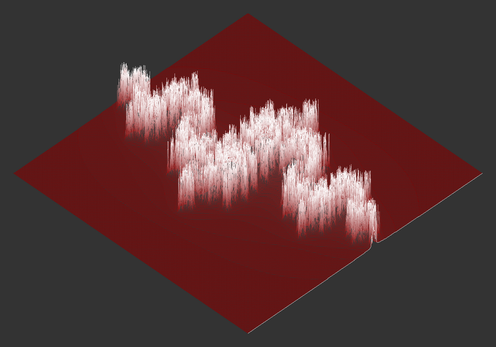
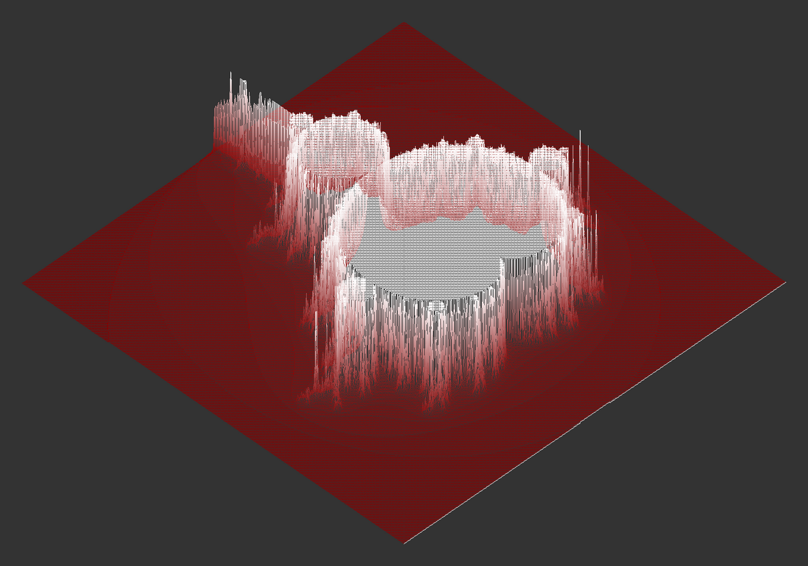
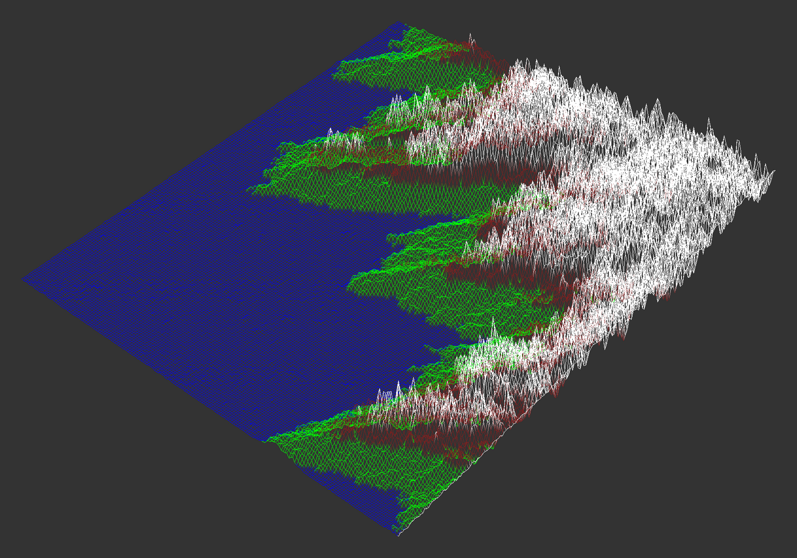
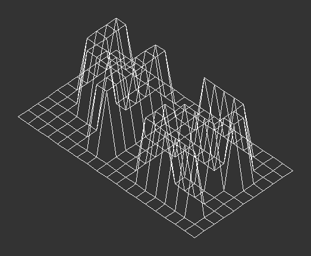

# FdF — 3D Wireframe Renderer

A wireframe renderer in C that turns a grid of height values into a 3D landscape, drawn in **isometric projection**. Graphics are rendered with [MLX42](https://github.com/codam-coding-college/MLX42).

<p align="center">
  
  
  
  
</p>

The input is a `.fdf` file: every number is the height (z) of a point on an x/y grid, optionally followed by a colour.

```
0  0  0  0  0
0 10 10 10  0
0 10 20,0xFF0000 10  0
0  0  0  0  0
```

## How it works

1. **Parsing and validation.** The map is read line by line, checked for a consistent width, and converted into a 2D array of points `(x, y, z, colour)`. Hex colours (`,0xRRGGBB`) are parsed per point.
2. **Fitting to the window.** The scale is calculated from the map size, so a 10×10 map and a 500×500 map both fill the window. The starting height scale is calculated from the map's height range, so the relief is visible without overwhelming the image.
3. **Isometric projection.** Each 3D point is scaled and mapped to 2D screen coordinates:

   ```
   screen_x = (x - y) · zoom · cos(θ) + offset_x
   screen_y = (x + y) · zoom · sin(θ) - z · zoom · z_scale + offset_y
   ```

   The x and y axes are rotated towards the viewer, and the height lifts the point upwards on screen.
4. **Line drawing.** Neighbouring points are connected with **Bresenham's line algorithm**, which uses only integer steps. Colours are interpolated pixel by pixel along each line, giving smooth gradients between points.
5. **Interaction.** Arrow keys move the model, `+` / `-` raise and lower the relief; `Esc` or closing the window exits cleanly.

## Build and run

Requires `cmake` and `glfw` for MLX42.

```bash
git clone --recursive https://github.com/katerynazinchuk/FdF.git
cd FdF
make
./FDF maps/test_maps/julia.fdf
```

| Key | Action |
|---|---|
| Arrow keys | Move the model |
| `+` / `-` | Raise / lower the relief |
| `Esc` | Quit |

## Project structure

```
src/
├── parser/   # reading and validating the .fdf map, building the point grid
├── render/   # isometric projection, Bresenham lines, colour interpolation
└── fdf/      # entry point, window setup, key handling, error handling
maps/         # test maps
```

Part of the [Codam](https://www.codam.nl/) (42 Network) curriculum.
